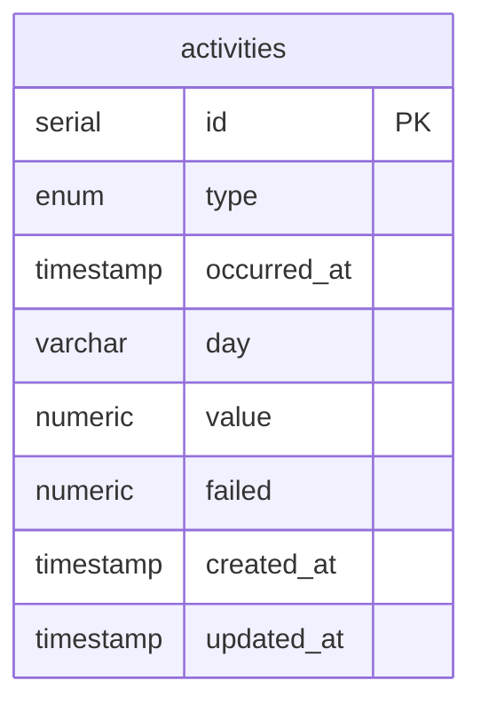

# Home Stats

Estado: **backend implementado. Automatización de GitHub pendiente.**
Fecha: 16 nov 2026.

Referencia para humanos y agentes IA. Define modelo real, endpoint de ingesta, agregación backend y contrato visual.

---

## 1. Principios

1. Las estadísticas son públicas.
2. No exponen posts privados ni datos de usuarios.
3. **El backend calcula todo**: sumas, promedios, deltas, detalles, series y huecos.
4. **El frontend solo pinta**: recibe `HomeStatsData` resuelto.
5. Un registro = una actividad registrada, no un día.
6. Puede haber varias actividades el mismo día.
7. Actividad no registrada = hueco (`null`), no cero.
8. Payload de ingesta plano. Sin objetos anidados.
9. La fecha se infiere en servidor si no se envía.
10. Automatización GitHub aplazada.

---

## 2. Archivos

### Backend

- `src/collections/Activities/index.ts`: colección Payload.
- `src/collections/Activities/endpoints/ingest.ts`: `POST /api/activities/ingest`.
- `src/collections/Activities/hooks/normalizeActivity.ts`: normalización y validación.
- `src/utilities/stats/config.ts`: configuración de los 4 stats y alias de ingesta.
- `src/utilities/stats/date.ts`: fecha/día en `America/Mexico_City`.
- `src/utilities/stats/aggregate.ts`: proyección `HomeStatsData`.
- `src/utilities/stats/numbers.ts`: coerción numérica y decodificación de boulder.
- `src/migrations/20261116_003500_add_activities_stats.ts`: tabla `activities`.
- `src/migrations/20261116_120000_simplify_boulder_stats.ts`: quita `attempts`.

### Frontend

- `src/components/archive/stats/home-stats.tsx`: cards y layout.
- `src/components/archive/stats/comparison-chart.tsx`: `ridgeline`, `line`, `bars`, `calendar`.
- `src/components/archive/stats/icons.tsx`: iconos.
- `src/components/archive/stats/types.ts`: contrato `HomeStatsData`.
- `src/app/(frontend)/page.tsx`: conecta `getHomeStats()`.

### Mock

- `src/data/home-stats.mock.json`: fallback solo en desarrollo cuando no hay ningún dato en DB.

---

## 3. Modelo de datos real

Una sola colección: `activities`.
Tabla Postgres: `activities`.
Enum: `enum_activities_type`.

### 3.1 UML / ER



### 3.2 Campos

| Campo | Tipo | Requerido | Notas |
|---|---|---|---|
| `type` | select | sí | `bike`, `coffee`, `boulder`, `code` |
| `occurredAt` | date | sí | Hora exacta o mediodía si solo hay fecha |
| `day` | text `YYYY-MM-DD` | sí | Derivado en `America/Mexico_City`; índice |
| `value` | number | simple | `bike`, `coffee`, `code`; en boulder = tops |
| `failed` | number | boulder | Intentos fallidos |

No existe `attempts`. El total de boulder se calcula como
`value + failed`.

### 3.3 Reglas

- Varias actividades el mismo día se suman al agregar.
- Boulder:
  - `value` = tops completados.
  - `failed` = intentos fallidos.
  - `value` y `failed` son enteros `>= 0`.
  - Total de intentos = `value + failed`.
  - El endpoint recibe un solo valor `tops.fallidos`, ej. `11.99`.
- Simple:
  - `value >= 0`.
  - `failed` queda `null`.
  - `code` exige entero.
- `day` se calcula en hook. No se confía en el cliente.
- No hay `idempotencyKey` por ahora. Cada POST crea una actividad nueva.

### 3.4 Configuración de stats

Vive en código, no en DB:

```ts
bike    -> Kilómetros rodados, ridgeline, km
coffee  -> Gramos de café molidos, line, g
boulder -> Intentos de boulder, bars
code    -> Frecuencia de código publicado, calendar
```

Agregar un stat nuevo requiere cambiar `src/utilities/stats/config.ts`.

---

## 4. Contrato visual

```ts
type StatValue = number | null

type HomeStatCardData = {
  id: string
  title: string
  icon: 'bike' | 'coffee' | 'boulder' | 'git'
  value: number
  unit?: string
  delta?: number
  tone: 'sage' | 'clay' | 'slate' | 'gold'
  featured?: boolean
  details?: Array<{ value: number; label: string }>
  chart:
    | { type: 'ridgeline'; current: StatValue[]; previous: StatValue[] | null }
    | { type: 'line'; current: StatValue[]; previous: StatValue[] | null }
    | { type: 'bars'; current: { completed: StatValue[]; failed: StatValue[] }; previous: StatValue[] | null }
    | { type: 'calendar'; current: StatValue[]; previous: StatValue[] | null }
}
```

Reglas:

- `null` = sin dato. Línea se corta; barra/dot no se dibuja.
- `0` = cero real. Se dibuja.
- `previous: null` = no hay mes anterior comparable. Se oculta delta y fantasma.
- Serie actual vacía = mes actual sin datos.

---

## 5. Endpoint de ingesta

### 5.1 Ruta

```http
POST /api/activities/ingest
```

### 5.2 Autenticación

```http
Authorization: Bearer ${STATS_INGEST_SECRET}
```

También acepta sesión de admin de Payload.

### 5.3 Contrato rápido

| `type` | `value` | Actividad |
|---|---|---|
| `"km"` | decimal o entero | Bici, kilómetros |
| `"gr"` | decimal o entero | Café, gramos |
| omitido o `null` | entero | Code, commits |
| omitido o `null` | decimal | Boulder, intentos |

El endpoint acepta también alias largos: `bi`, `bici`, `bike`, `ca`,
`cafe`, `coffee`, `bo`, `boulder`, `co`, `codigo`, `code`.

Body plano. Sin objetos anidados.

Bici:

```json
{ "type": "km", "value": 42.5 }
```

Café:

```json
{ "type": "gr", "value": 120 }
```

Código, sin `type`:

```json
{ "value": 9 }
```

Boulder, sin `type`:

```json
{ "value": 11.99 }
```

### 5.4 Boulder compacto

Boulder usa un solo número: `tops.fallidos`.

- `11.99` = 11 tops, 99 fallidos, 110 intentos totales.
- `11.4` = 11 tops, 4 fallidos, 15 intentos totales.
- `"11.10"` = 11 tops, 10 fallidos.
- `"11.00"` = 11 tops, 0 fallidos.

Como `11.10` en JSON numérico se convierte en `11.1`, mandar string
cuando los fallidos tengan cero final o más de un dígito ambiguo.

Boulder con cero fallidos también puede usar el alias explícito:

```json
{ "type": "bo", "value": 11 }
```

### 5.5 Fecha opcional

```json
{ "type": "gr", "value": 120, "date": "2026-11-15" }
```

- `date` formato `YYYY-MM-DD`.
- Si falta, se usa el momento actual y se deriva el día en
  `America/Mexico_City`.
- No se aceptan fechas futuras.
- No hay arrays ni objetos anidados.

### 5.6 Respuesta

Boulder `11.99`:

```json
{
  "ok": true,
  "id": 123,
  "type": "boulder",
  "day": "2026-11-16",
  "value": 11,
  "failed": 99,
  "total": 110
}
```

Code `9`:

```json
{
  "ok": true,
  "id": 124,
  "type": "code",
  "day": "2026-11-16",
  "value": 9,
  "failed": null,
  "total": 9
}
```

### 5.7 Errores

| Código | Caso |
|---|---|
| `400` | JSON inválido, `type` desconocido, fecha inválida |
| `401` | Sin secret ni sesión admin |
| `422` | `value` inválido, code decimal, boulder mal formado |
| `500` | Error de DB |

### 5.8 Ejemplo curl

```bash
curl -X POST https://lunares.mx/api/activities/ingest \
  -H "Authorization: Bearer $STATS_INGEST_SECRET" \
  -H "Content-Type: application/json" \
  -d '{"value":11.99}'
```

```bash
curl -X POST https://lunares.mx/api/activities/ingest \
  -H "Authorization: Bearer $STATS_INGEST_SECRET" \
  -H "Content-Type: application/json" \
  -d '{"type":"km","value":42.5}'
```

---

## 6. Agregación backend

`getHomeStats()` en `src/utilities/stats/aggregate.ts`.

### 6.1 Periodos

- Mes actual y mes anterior en `America/Mexico_City`.
- `currentEnd` = último día del mes actual con actividad.
- Serie actual corta en `currentEnd`.
- Serie anterior usa el mes completo.

### 6.2 Valores

- `card.value` = suma de `value` del mes actual.
- En boulder, `card.value` = suma de `value + failed`.
- `delta` solo si:
  - hay serie anterior
  - `previousValue > 0`
- Comparación contra el total del mes anterior completo.

### 6.3 Series

| Chart | Bucket | Huecos |
|---|---|---|
| `ridgeline` | punto registrado | huecos se conectan; no implica cero |
| `line` | día | `null` corta línea |
| `bars` | semana | semana sin datos = `null` |
| `calendar` | día | `null` sin dato; `0` cero real |

Boulder en `bars`:

- `completed` = `value` (tops).
- `failed` = `failed`.
- Altura total = `completed + failed`.

### 6.4 Detalles

- Boulder: `tops` = suma de `value`; `fallidos` = suma de `failed`.
- Código: promedio por día transcurrido hasta el último dato y días activos (`value > 0`).
- Bici/café: sin detalles.

### 6.5 Frontend

El homepage llama `getHomeStats()` en server component.

En desarrollo, si no hay ningún dato en DB, usa `home-stats.mock.json` para conservar el diseño. En producción no usa mock.

Cada POST invalida `/` con `revalidatePath('/')`.

---

## 7. Seguridad

- `activities.read` solo admin.
- `create`, `update`, `delete` solo admin.
- Endpoint valida secret o admin.
- Agregados públicos.
- No leer activities crudas desde el cliente.
- No loggear `STATS_INGEST_SECRET`.

---

## 8. Automatización GitHub: pendiente

No implementada.

Cuando se retome:

- GitHub GraphQL `contributionsCollection`.
- Un registro `code` por día con `value = contributionCount`.
- Días con cero contribuciones se registran con `value: 0`.
- Día sin sincronizar queda ausente = hueco.
- Opción recomendada: GitHub Action diaria con PAT `read:user`.
- Alternativa: extender el cron diario de Vercel.
- Si se agrega upsert, usar una llave idempotente `github:code:YYYY-MM-DD`.

---

## 9. Verificación

- `pnpm exec tsc --noEmit` pasa.
- `parseBoulderValue(11.99)` devuelve `tops=11`, `failed=99`, `total=110`.
- `parseBoulderValue("11.10")` devuelve `failed=10`.
- `isDecimalValue(11.99)` = `true`; `isDecimalValue(5)` = `false`.
- `parseStatType("km")` = `bike`; `parseStatType("gr")` = `coffee`.

Pendiente: prueba de integración completa contra Postgres después de
correr la migración.

---

## 10. Pendientes

- Automatización GitHub.
- Diseño de empty state más rico para meses sin datos.
- Tests automatizados del endpoint y agregación.
- Idempotencia si se automatiza ingesta.
- Decidir si se agregan métricas nuevas desde DB o solo por código.

---

## 11. Referencia para mantenimiento por agentes IA

### Invariantes

- Tipos canónicos internos: `bike`, `coffee`, `boulder`, `code`.
- Alias de ingesta viven solo en `src/utilities/stats/config.ts`.
- En DB, boulder usa `value = tops` y `failed = fallidos`. Nunca
  guardar el total en `value`.
- El total de boulder siempre se deriva con `value + failed`.
- Code exige entero. Bici y café aceptan decimales.
- `day` se deriva en `America/Mexico_City`; el cliente no lo manda.
- Un POST crea un registro. No hay upsert todavía.

### Flujo de ingesta

1. `ingest.ts` valida secret, body y `date`.
2. `ingest.ts` resuelve `type`: alias explícito o inferencia por `value`.
3. Entero sin `type` = `code`; decimal sin `type` = `boulder`.
4. `normalizeActivity.ts` normaliza de nuevo, valida y calcula `day`.
5. `payload.create()` guarda `value` y `failed`.

### Cambios de schema

- No editar migraciones ya aplicadas. Agregar una nueva.
- Después de cambiar la colección, correr `pnpm generate:types`.
- Después de cambiar lógica, correr `pnpm exec tsc --noEmit`.
- La migración `20261116_120000_simplify_boulder_stats.ts` convierte
  boulder viejo (`attempts - failed`) a `value` y borra `attempts`.

### Superficies que deben seguir en sync

- `src/collections/Activities/index.ts`
- `src/collections/Activities/endpoints/ingest.ts`
- `src/collections/Activities/hooks/normalizeActivity.ts`
- `src/utilities/stats/config.ts`
- `src/utilities/stats/numbers.ts`
- `src/utilities/stats/aggregate.ts`
- `src/components/archive/stats/types.ts`
- `src/payload-types.ts`
